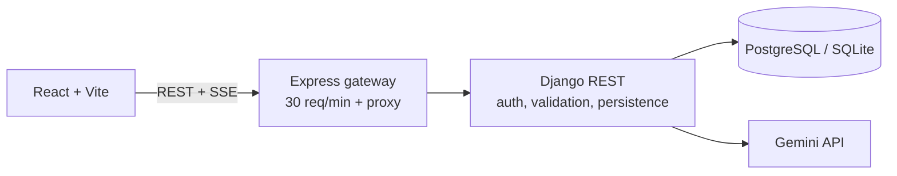

# QueryQuill AI

Portfolio-ready conversational assistant using React, TypeScript, Django REST Framework, PostgreSQL/SQLite, Gemini, and an Express gateway.

## Architecture

Django owns users, chats, permissions, persistence, and LLM access. Express supplies a focused rate-limit boundary and transparently proxies streaming responses; it does not duplicate business logic. Gemini keys remain server-side. Without a configured key the UI displays a clear error rather than inventing a reply.

## Database and API

Django's built-in `User` owns `ChatSession` records, each with ordered `ChatMessage` records storing role, content, and timestamp. Cascading foreign keys remove messages with their parent session. API routes: `POST /api/auth/register/`, `POST /api/auth/login/`, `GET/POST /api/chats/`, `GET /api/chats/{id}/messages/`, `DELETE /api/chats/{id}/`, `POST /api/chat/` (SSE), and public `GET /api/health/`. Private routes require `Authorization: Token <token>`.

## Local setup

Needs Python 3.11+, Node.js 20+, and optionally PostgreSQL. SQLite is default.

1. Copy `.env.example` to `.env`; set a strong `DJANGO_SECRET_KEY` and your `GEMINI_API_KEY`.
2. Django: `cd backend-django`; create and activate a virtual environment; `pip install -r requirements.txt`; `python manage.py makemigrations chat`; `python manage.py migrate`; `python manage.py runserver`.
3. Express: `cd node-service`; `npm install`; `npm run dev`.
4. React: `cd frontend`; `npm install`; `npm run dev`.
5. Open Vite's local URL, register an account, and ask a question.

For PostgreSQL set `DB_ENGINE=postgres`, `DB_NAME`, `DB_USER`, `DB_PASSWORD`, `DB_HOST`, and `DB_PORT` before migrating. The frontend API URL defaults to `http://localhost:4000`.

## Verification

Run backend tests with `python manage.py test` inside `backend-django`. Run the frontend smoke test with `npm install` then `npm test` inside `frontend`. Use Postman to register, then send `Authorization: Token <token>` with chat/history requests. A chat request body is `{"chat_id":1,"message":"Explain recursion","model":"gemini-2.0-flash","temperature":0.7}`; its SSE chunks are `{ "text": "..." }`, followed by `{ "done": true }`. Gateway health is `/gateway-health`, Django health is `/api/health/`.

## Deployment and security

Deploy Django and Express as separate services, PostgreSQL as managed storage, and Vite's production `dist/` to a static host. Set backend secrets and `DJANGO_URL`, `DEBUG=false`, explicit `ALLOWED_HOSTS` and `CORS_ALLOWED_ORIGINS`, use HTTPS, and run migrations during release. Django scopes history reads/deletes and generation to the authenticated owner, caps messages at 12,000 characters, and applies per-user throttles. Express caps requests at 30/minute/client. Do not use development secrets in production.

Screenshot checklist: desktop welcome, populated answer with code, mobile navigation drawer, settings panel.

## Resume and interview

**Resume:** Built QueryQuill AI, a full-stack conversational assistant with a responsive React/TypeScript client, Django REST APIs, token authentication, private persistent history, Gemini SSE streaming, SQLite/PostgreSQL support, and an Express rate-limiting gateway.

- **Why both Django and Express?** Django implements application rules and persistence. Express is a small edge gateway that rate-limits and passes SSE through.
- **How are conversations private?** Every session lookup filters by the request user before reading, deleting, or generating an answer.
- **How does the answer stream?** Gemini chunks become Django SSE events; Express pipes them; React reads the stream and appends text progressively.
- **What are next steps?** Add refresh-token expiry, PostgreSQL CI, operational metrics, and opt-in document RAG.

RAG upload, deployment automation, and automated frontend tests are not included in this version.
